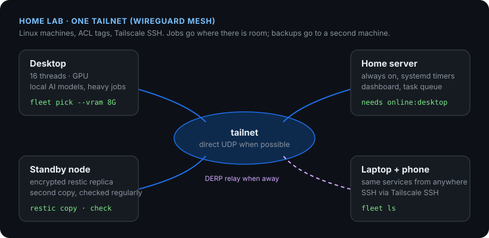

### Network engineer with a Linux sysadmin background

I support and troubleshoot enterprise networks (routing and switching, VLANs and trunks,
DNS/DHCP) and Linux/VMware hosts, and I automate the boring parts. Currently studying
CCNP ENCOR, Wi-Fi and data-center fabrics.

At home I run a small Linux lab on one [Tailscale](https://tailscale.com) network:
machines that pick up jobs when they have room, skip work politely when a dependency is
away, and keep encrypted backup copies on a second node.

#### Projects

| Repo | What it is |
| --- | --- |
| [tailnet-fleet](https://github.com/navybliss/tailnet-fleet) | See every machine on a tailnet (direct or DERP-relayed path), probe CPU, memory pressure, disk and GPU over SSH, and pick the node with room for a job. Python + POSIX sh. |
| [needs](https://github.com/navybliss/needs) | Check a job's dependencies (TCP port, URL, DNS, Tailscale peer, mount, free disk) and run it, or skip it with one plain reason per problem. Drops into systemd `ExecCondition=`. POSIX sh. |
| [dev](https://github.com/navybliss/dev) | Script that builds my development environment on a minimal Arch Linux install. |
| [zmk-config-corne-3x6](https://github.com/navybliss/zmk-config-corne-3x6) | Firmware layout for my split keyboard. |

**Tools I use:** Linux (Arch, Ubuntu, RHEL family) · Bash/POSIX sh · Python · systemd · SSH ·
Tailscale/WireGuard · restic · Git · Cisco IOS/NX-OS CLI

*Much of the code here is written together with AI coding agents (Claude Code, Codex)
that I direct; the problems and designs come from my own setup.*
